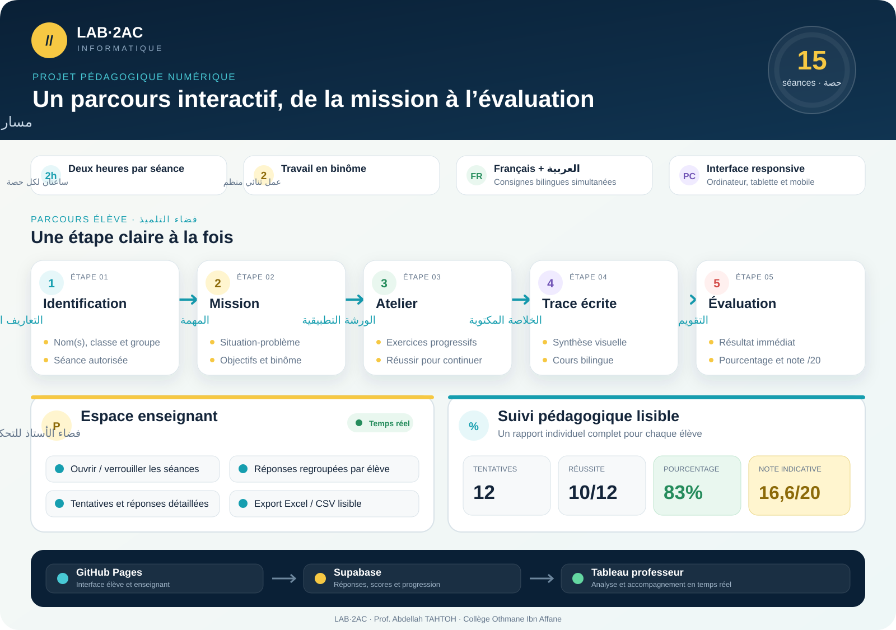

# LAB·2AC — 15 séances d’informatique

## Version 2

- propositions mélangées automatiquement dans les exercices, défis et QCM ;
- réponses reçues enrichies avec la question, le choix de l’élève et la réponse attendue ;
- tableau professeur complété par un aperçu des réponses, les pourcentages et les statistiques par élève ;
- export CSV lisible dans Excel avec une ligne par question et des colonnes distinctes pour les scores.

Parcours bilingue français–arabe destiné aux élèves de 2AC. Chaque séance dure deux heures et privilégie la manipulation : exercices progressifs, situations-problèmes, ateliers, images réelles, évaluations et trace écrite.

## Vue d’ensemble du projet



Le parcours élève associe identification, mission, atelier progressif, trace écrite et évaluation. L’espace enseignant permet de piloter l’accès aux séances et de suivre les réponses, les tentatives, la progression, le pourcentage de réussite et la note indicative de chaque élève.

## Accès

L’espace professeur est protégé par mot de passe. Il affiche les élèves et binômes, chaque tentative avec sa date et son heure au Maroc, les réponses détaillées, les scores, la progression et l’export CSV.

## Architecture

- Next.js 16 en export statique
- GitHub Pages via GitHub Actions
- Supabase pour les inscriptions et les tentatives
- fonction Supabase Edge pour la validation, l’écriture et l’accès professeur
- RLS activé et accès direct `anon` / `authenticated` refusé sur les tables

Les clés privées Supabase ne sont jamais incluses dans le frontend. Seule la clé publiable est utilisée par le navigateur ; toutes les opérations passent par la fonction Edge validée côté serveur.

## Développement

```bash
pnpm install
pnpm dev
```

Compilation de production :

```bash
pnpm build
```

Les migrations et la fonction Supabase sont conservées dans `supabase/`.

## Séance 3 · ateliers et bilan

Les 25 exercices occupent 100 minutes (rappel 25, découverte 20, pratique 55), avec 5 minutes d’installation, 5 de trace écrite et 10 de bilan individuel. Les consignes et les aides sont en français avec traduction arabe de la phrase au survol et au clavier.

Les exercices 13, 17, 19, 23, 24 et 25 utilisent un bureau d’entraînement inspiré de Windows 11 : fenêtres, calculatrice, Explorateur, dossiers, presse-papiers, renommage et Corbeille. Son système de fichiers est virtuel. Les élèves refont ensuite les gestes sur leur poste Windows. Références : [Explorateur de fichiers](https://support.microsoft.com/fr-fr/windows/experience/fileexplorer/file-explorer-in-windows) et [raccourcis Windows](https://support.microsoft.com/fr-fr/windows/raccourcis-clavier-dans-windows-dcc61a57-8ff0-cffe-9796-cb9706c75eec).

Le bilan remplace le QCM de la séance 3 par trois situations : classer six éléments (6 points), reconnaître le contenu de quatre fichiers (4 points), organiser un dossier dans le simulateur (10 points). La correction apparaît après confirmation de remise. La tentative transmise au tableau professeur comprend les 15 critères et l’état du dossier. Le brouillon reste dans la session du navigateur. La fonction serveur accepte le contrat `session3-bilan-situations-v5`, recalcule les critères à partir des choix et du dossier transmis, et vérifie la cohérence du total sur 20. Les règles de la séance 2 restent distinctes. Les scores sont indicatifs : le dispositif reste un entraînement côté navigateur, et l’observation des gestes sur le poste complète l’évaluation.

Les schémas de conversion et d’exemples de systèmes d’exploitation proviennent des supports fournis par l’enseignant. Les conversions utilisent les multiples décimaux : 1 Ko = 1 000 octets ; 1 octet = 8 bits. La carte du système distingue composants internes et périphériques externes.

Photographie du clavier : Pixloom, [Wireless Computer Keyboard](https://commons.wikimedia.org/wiki/File:Wireless_Computer_Keyboard.jpg), [CC BY-SA 4.0](https://creativecommons.org/licenses/by-sa/4.0), sans modification. Les informations de crédit figurent aussi dans `public/session3/ressources/clavier-credit.json`.

## Auteur

Prof. Abdellah TAHTOH — Collège Othmane Ibn Affane

Validation du contrat et de la réception des évaluations (sans requête réseau ni écriture en production) : `node scripts/test-session3-backend.cjs`.
